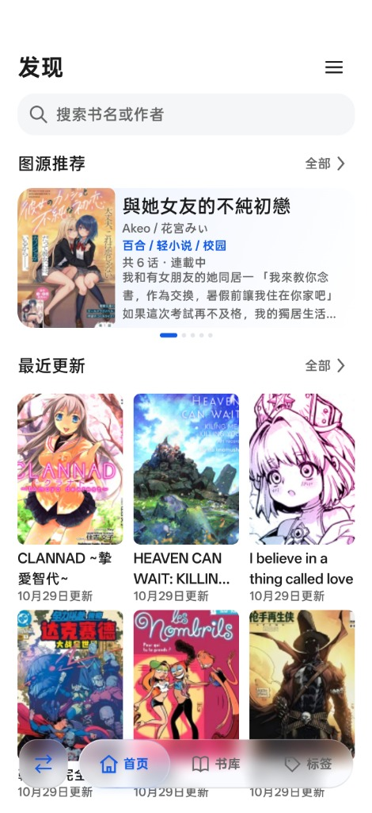
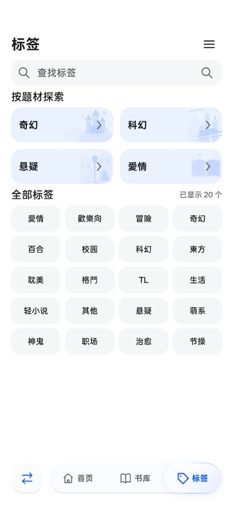
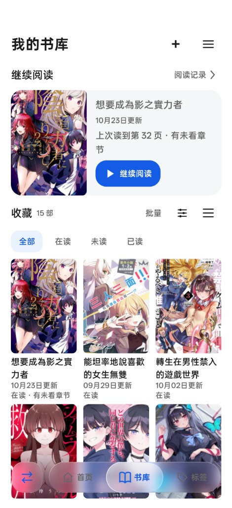
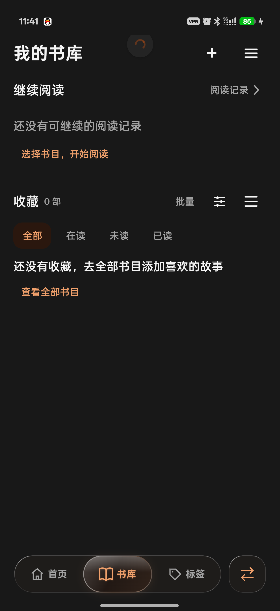

<div align="center">


# FluxManga · 流光漫匣

**想看的漫画，放进同一个书库。**

一款 Android 漫画阅读器，连接在线图源与本地 CBZ，陪你从发现新作读到下一话。

[下载最新版](https://github.com/Mikuku-Kawaii/FluxManga/releases/latest) · [功能介绍](#功能介绍) · [支持的来源](#支持的来源) · [反馈问题](https://github.com/Mikuku-Kawaii/FluxManga/issues)

[](https://github.com/Mikuku-Kawaii/FluxManga/releases/latest)
[](#下载与安装)
[](LICENSE)



<sub>实际应用界面 · 作品及封面版权属于各自权利人</sub>

</div>

## 功能介绍

### 发现下一部想读的作品

首页展示图源推荐和最近更新。通过关键词、作者或标签寻找漫画，可以一起查看多个来源的结果，也可以进入单个来源浏览。各来源独立加载和重试，找到喜欢的作品后可以加入书库。

<p align="center">
  
  
</p>

### 整理自己的书库

在线漫画和本地 CBZ 可以放进书库，以网格或列表浏览。收藏、标签、分组、阅读状态筛选和排序帮助你整理作品；继续阅读入口保存上次阅读的位置。长按作品可批量选择或取消收藏。

图源账号的收藏或书架可以导入当前空间，已有书目和阅读进度会保留。各来源的导入范围依网站和账号权限而不同；这不是跨设备的阅读进度同步。本地 CBZ 导入后保存应用副本，原文件保留在原处。

<p align="center">
  
</p>

### 按自己的方式阅读

阅读器默认全屏，轻触画面呼出章节、书签和页码工具。支持从左向右、从右向左、上下逐页和连续条漫阅读，可缩放、使用音量键翻页，宽屏还可使用双页。

接近章节末尾时预加载下一话；到达当前目录的最后一话后可返回详情。已完结作品在确认末章末页显示后标记为已读，保留阅读位置。支持下载的章节可离线阅读，阅读记录和统计帮助你回顾阅读时间。

### 两个空间，两份书库

表世界采用白蓝配色，里世界采用黑橙配色。两个空间分别保存书库、进度、账号和缓存，可以通过底部切换键进入。里世界提供加密存储、窗口保护和可选身份验证；可在设置中选择退出后自动返回表世界的等待时间。

界面提供低效果和减少动画选项，漫画正文不模糊。窗口保护会阻止系统截取里世界画面；空间保护仍需配合设备自身的安全设置使用。

<p align="center">
  
</p>

<sub>里世界界面：独立截图版的空书库，不含个人阅读记录或作品。</sub>

<a id="ui-reference-20261019"></a>

## 支持的来源

| 来源 | 适合做什么 | 使用前需要知道 |
| --- | --- | --- |
| **本地 CBZ** | 导入漫画文件、离线阅读 | 应用保存副本，原文件保留 |
| **Komga** | 浏览和阅读自己的漫画服务器 | 需要自行配置服务器和访问凭据 |
| **拷贝漫画** | 浏览、搜索、阅读和导入云收藏 | 支持应用内网页登录，导入范围取决于接口 |
| **包子漫画** | 浏览、阅读和导入网站书架 | 可能需要登录或浏览器验证，书架范围以网站返回为准 |
| **JMComic** | 在里世界浏览、搜索、阅读及导入收藏 | 可用线路和内容取决于服务与账号 |
| **PicACG** | 在里世界浏览、搜索、阅读及导入收藏 | 需要有效账号，可手动导入网页会话 Token |
| **E-Hentai / ExHentai** | 在里世界搜索、阅读画廊及导入收藏 | ExHentai 权限需要单独确认 |

各来源的功能、登录方式和导入范围不同。项目不提供漫画资源、账号或服务镜像。[查看详细图源说明](docs/release/supported-sources.md)。

> [!NOTE]
> 部分图源可能需要可用的网络代理才能正常访问，具体取决于所在网络和站点状态；请自行配置设备网络。

## 下载与安装

从 [GitHub Releases](https://github.com/Mikuku-Kawaii/FluxManga/releases/latest) 下载最新的通用 APK，支持 **Android 12 / API 31 及以上**、arm64-v8a 和 x86_64。

首次安装时按 Android 提示允许来源安装。同签名旧版可直接覆盖升级；签名冲突时请先核对安装包来源。应用启动时会检查更新，也可以在「设置 → 关于与更新」手动检查；下载完成后由 Android 确认安装。

## 开始使用

1. 安装并打开应用，在首页浏览推荐，或通过搜索和标签寻找作品。
2. 在「设置 → 图源管理」按需连接账号或配置 Komga 服务器；如果图源无法连接，检查网络及代理设置。
3. 从图源管理导入收藏，或在书库导入本地 CBZ，整理收藏与标签。
4. 打开作品阅读，轻触画面切换阅读方式、查看目录、添加书签或跳转页码。
5. 需要不同的书库与账号时切换表里空间，分别配置来源。

更换设备前，可通过应用的备份与记录导出功能保存需要的数据，并妥善保留本地漫画原文件。

## 构建与贡献

项目界面使用 Jetpack Compose；Android 层管理生命周期、业务数据和图片，部分核心能力与图源协议由 Rust 实现，通过 UniFFI 与 Kotlin 连接。当前构建脚本面向 **Windows x64**，需要 JDK 17、Android SDK 36、Build Tools 35.0.0、NDK 28.2.13676358 和 Rust 工具链。

```powershell
git clone https://github.com/Mikuku-Kawaii/FluxManga.git
cd FluxManga
.\gradlew.bat :app:assembleDebug
```

<details>
<summary>构建环境与签名说明</summary>

详细配置见[构建与安装](docs/release/build-and-install.md)。自行签名的构建通常不能覆盖官方安装包。

</details>

<a id="upstream-reuse"></a>

项目在固定版本与许可条件下参考上游实现，保留相应版权及修改说明，详见[第三方声明](THIRD_PARTY_NOTICES.md)。欢迎提交 [Issue](https://github.com/Mikuku-Kawaii/FluxManga/issues) 或 Pull Request；反馈时请提供应用与 Android 版本、图源及重现步骤，不要附上密码、Token 或私密内容。

## 许可证

FluxManga 自有代码采用 [GPL-3.0-only](LICENSE)。第三方代码、依赖和素材遵循各自许可，详见 [LICENSING.md](LICENSING.md) 与 [THIRD_PARTY_NOTICES.md](THIRD_PARTY_NOTICES.md)。
