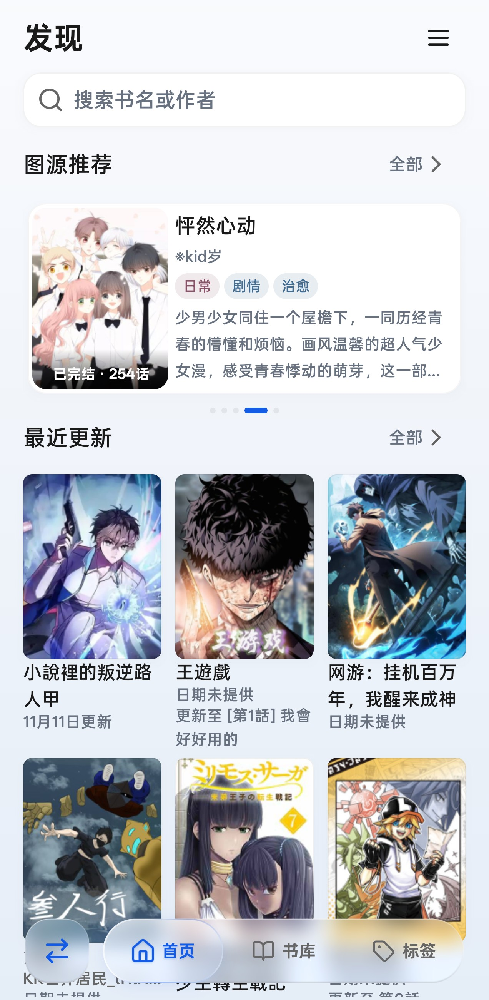
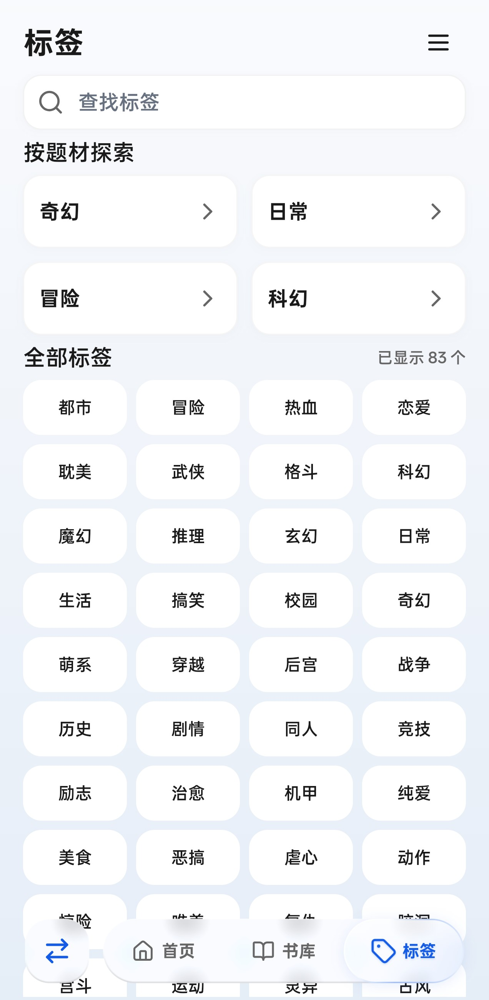
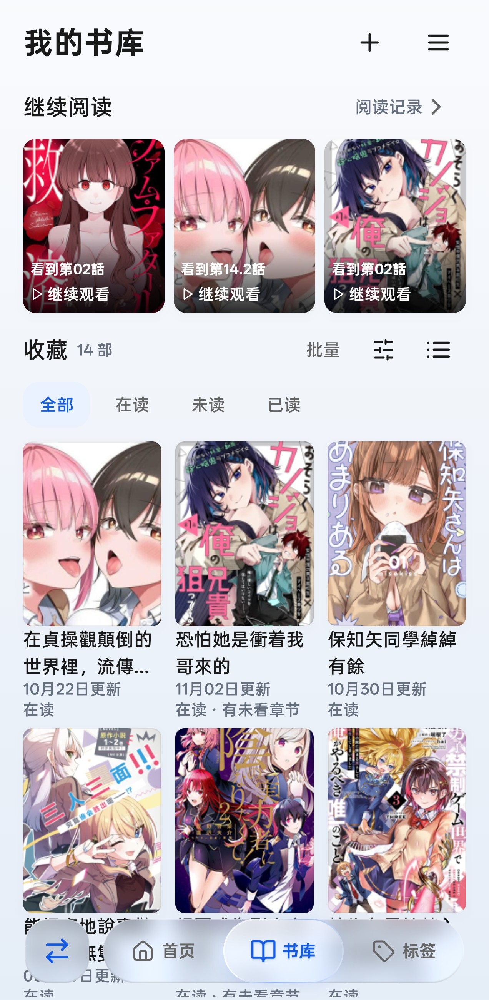
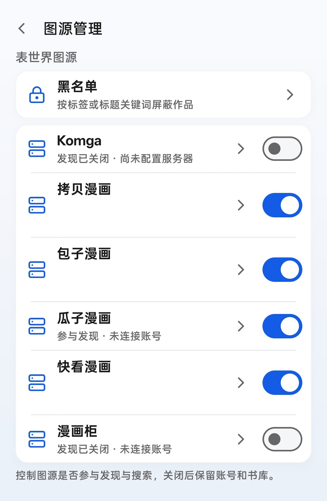
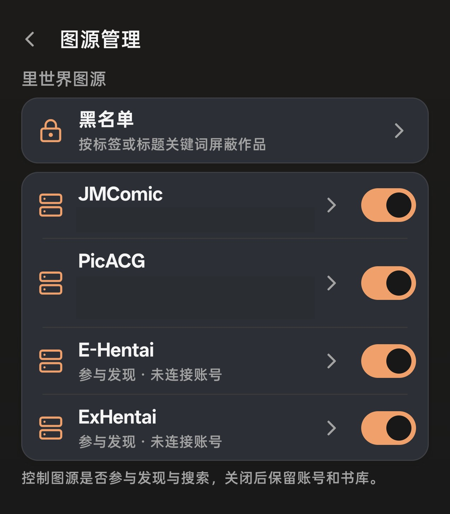

<div align="center">

  

  <h1>FluxManga · 流光漫匣</h1>

  <p><strong>想看的漫画，放进同一个书库。</strong></p>

  <p>
    一款采用液态玻璃界面的 Android 双空间漫画阅读器。<br />
    聚合在线图源、Komga 与本地 CBZ，陪你从发现新作流畅读到下一话。
  </p>

  <p>
    <a href="https://github.com/Mikuku-Kawaii/FluxManga/releases/latest">
      
    </a>
    <a href="#下载与安装">
      
    </a>
    
    
    <a href="LICENSE">
      
    </a>
    <a href="https://github.com/Mikuku-Kawaii/FluxManga/stargazers">
      
    </a>
  </p>

  <p>
    <a href="https://github.com/Mikuku-Kawaii/FluxManga/releases/latest"><strong>下载最新版</strong></a>
    &nbsp;·&nbsp;
    <a href="#界面预览">界面预览</a>
    &nbsp;·&nbsp;
    <a href="#功能介绍">功能介绍</a>
    &nbsp;·&nbsp;
    <a href="#支持的来源">支持的来源</a>
    &nbsp;·&nbsp;
    <a href="#开始使用">开始使用</a>
    &nbsp;·&nbsp;
    <a href="https://github.com/Mikuku-Kawaii/FluxManga/issues">反馈问题</a>
  </p>

</div>

---

## 核心亮点

<table>
  <tr>
    <td width="25%" valign="top">
      <strong>多源聚合发现</strong><br /><br />
      汇聚多站点推荐、最近更新与标签检索，支持跨源搜索与单源独立加载重试。
    </td>
    <td width="25%" valign="top">
      <strong>统一本地与云书库</strong><br /><br />
      在线漫画、自建 Komga 与本地 CBZ 同库管理，支持分组、标签筛选与云收藏导入。
    </td>
    <td width="25%" valign="top">
      <strong>沉浸式流畅阅读</strong><br /><br />
      支持条漫、日漫、页漫与宽屏双页模式，具备分块预热、整章预取与离线下载阅读。
    </td>
    <td width="25%" valign="top">
      <strong>表里双空间隔离</strong><br /><br />
      表世界（白蓝）与里世界（黑橙）完全独立存储，提供加密缓存、窗口保护与身份验证。
    </td>
  </tr>
</table>

---

## 界面预览

### 发现、标签与书库

<table>
  <tr>
    <td align="center" width="33%">
      
      <br />
      <sub><strong>首页发现</strong> · 推荐与最近更新</sub>
    </td>
    <td align="center" width="33%">
      
      <br />
      <sub><strong>标签探索</strong> · 按题材快速筛选</sub>
    </td>
    <td align="center" width="33%">
      
      <br />
      <sub><strong>统一书库</strong> · 续读卡与多维整理</sub>
    </td>
  </tr>
</table>

### 表里双空间与图源管理

<table>
  <tr>
    <td align="center" width="50%">
      
      <br />
      <sub><strong>表世界</strong> · 白蓝清透配色与常规图源</sub>
    </td>
    <td align="center" width="50%">
      
      <br />
      <sub><strong>里世界</strong> · 黑橙暗色配色与独立加密空间</sub>
    </td>
  </tr>
</table>

---

## 功能介绍

### 发现与书库整理

- **聚合探索**：首页集中呈现各图源推荐与最近更新，支持关键词、作者或标签跨源检索，各来源独立加载与重试，互不阻塞。
- **高效书库管理**：在线漫画与本地 CBZ 统一收纳，支持网格 / 列表视图、分组、标签、阅读状态筛选、排序以及长按批量操作；顶部续读卡片直达上次阅读位置。
- **云收藏导入与本地副本**：支持将图源账号的收藏或书架导入当前空间，保留已有书目与阅读进度；导入本地 CBZ 时保存应用副本，原文件保持不动。
- **按空间标签黑名单**：可在「设置 → 图源管理 → 标签黑名单」中分别为表里空间配置屏蔽标签。输入联想完全基于本地词典与缓存（支持原文 / 译名、大小写及全半角归一化），不逐字联网，也不因过滤而额外触发逐本详情请求。

### 沉浸阅读与智能缓存

- **多种阅读模式**：默认全屏沉浸阅读，轻触屏幕呼出章节目录、书签与页码工具；支持**从左向右**、**从右向左**、**上下逐页**、**连续条漫**及**宽屏双页**，支持双指缩放与音量键翻页。
- **预加载与顺滑回看**：在线与本地 CBZ 条漫均自动预热相邻分块，回看优先展示清晰缓存或轻量预览；阅读当前章时持续后台预取，临近章末自动衔接下一话，已完结作品读至末章末页后自动标记已读。
- **离线阅读与阅读统计**：支持章节下载离线阅读，完整记录阅读历史与阅读时长统计。

<details>
<summary><strong>展开查看：缓存策略与内存预算说明</strong></summary>

- **先显后更**：首页、搜索、标签与详情页优先展示本地已缓存内容，再按需联网刷新；刷新失败时保留旧内容并提供重试，单张封面或单个来源异常不会清空整页。
- **内存与存储保护**：封面与阅读解码缓存共享内存上限（最大堆 1/4，最高 128 MiB），当前阅读请求始终优先于后台预取；存储空间不足时自动停止预加载并提示。
- **安全清理**：可在「存储与清理」中一键释放临时缓存，同时安全保留活动阅读文件、书库资料、阅读进度、离线下载与用户原文件。需要长期离线保存的章节请使用正式下载功能。

</details>

### 两个空间，两份书库

| 特性 | 表世界（白蓝配色） | 里世界（黑橙配色） |
| :--- | :--- | :--- |
| **数据隔离** | 独立书库、阅读进度、账号、标签黑名单与缓存 | 独立书库、阅读进度、账号、标签黑名单与缓存 |
| **快速切换** | 底部导航切换键进入 | 支持设置退出后自动返回表世界的等待时长 |
| **隐私与保护** | 常规窗口与液态玻璃界面（可选低效果 / 减少动画） | 加密存储、后台遮挡、可选身份验证与默认禁止截图 |

> [!TIP]
> 如需在里世界临时截图，可在「设置 → 隐私」中开启「允许里世界截图」（默认关闭，仅保存在本机，关闭后立即恢复窗口保护；账号网页登录窗口始终禁止截图）。空间保护建议配合设备自身锁屏安全共同使用。

<a id="ui-reference-20261019"></a>

---

## 支持的来源

| 空间 | 来源 | 核心能力 | 使用说明 |
| :---: | :--- | :--- | :--- |
| 通用 | **本地 CBZ** | 导入本地漫画、完全离线阅读 | 应用保存副本，原文件保留在原处 |
| 通用 | **Komga** | 连接并阅读自建漫画服务器 | 需自行配置服务器地址与访问凭据 |
| 表世界 | **拷贝漫画** | 浏览、搜索、阅读、导入云收藏 | 支持应用内网页登录；含只读备用线路 |
| 表世界 | **包子漫画** | 浏览、阅读、导入网站书架 | 可能需要登录或浏览器验证 |
| 表世界 | **瓜子漫画** | 推荐、更新、搜索、题材、阅读与下载 | 支持网页登录连接账号，原站收藏导入待接入 |
| 表世界 | **快看漫画** | 推荐、新上架、搜索、题材与公开章节 | 支持官网网页登录，章节权限遵循原站 |
| 表世界 | **漫画柜** | 推荐、更新、搜索、题材、章节与阅读 | 支持用户名 / 邮箱登录，自动续章不跨目录分组 |
| 里世界 | **JMComic** | 浏览、搜索、阅读、导入收藏 | 支持 API 与图片 CDN 自动换线，换线保留账号 |
| 里世界 | **PicACG** | 浏览、搜索、阅读、导入收藏 | 支持应用内网页登录 / 注册、加密封面缓存与备用线路 |
| 里世界 | **E-Hentai / ExHentai** | 搜索、画廊阅读、导入收藏与本地标签词典 | ExHentai 访问权限需单独确认 |

> [!NOTE]
> 各来源的可用性、登录方式与收藏导入范围受原站接口限制；本项目不提供任何漫画资源、账号或服务镜像，部分图源可能需要可用的网络代理才能访问。详情请参阅 [详细图源说明](docs/release/supported-sources.md)。

<details>
<summary><strong>展开查看：多线路容灾与网络优化机制</strong></summary>

- 图源官方 App、网页与本软件可能使用不同的 API / CDN 线路，官方 App 可直连并不等同于所有接口均可直连。
- **自动换线**：JMComic、拷贝漫画匿名阅读及 PicACG 只读接口支持在已确认备用线路与图片 CDN 候选间自动切换，同时保留手动线路选择；换线过程保留账号、书库与进度，不自动重放登录或写入请求。
- **稳健重试**：失效的正文或封面地址支持自动重取，下载暂停时保留已下载字节，错误提示明确区分域名解析、安全连接与连接重置问题。

</details>

---

## 下载与安装

前往 [GitHub Releases](https://github.com/Mikuku-Kawaii/FluxManga/releases/latest) 下载最新通用 APK：

- **系统要求**：Android 12（API 31）及以上
- **架构支持**：`arm64-v8a` / `x86_64`（通用包）
- **安装与更新**：首次安装按系统提示允许未知来源安装；同签名版本可直接覆盖升级。应用启动时自动检查更新，也可在「设置 → 关于与更新」中手动检查。

---

## 开始使用

1. **发现作品**：安装后在首页浏览推荐与最近更新，或通过搜索和标签寻找漫画。
2. **配置图源**：在「设置 → 图源管理」按需登录图源账号或连接自建 Komga 服务器。
3. **整理书库**：导入图源云收藏或本地 CBZ 文件，使用分组、标签与黑名单管理书单。
4. **开始阅读**：打开章节后轻触屏幕切换阅读方向、呼出目录、添加书签或跳转页码。
5. **切换空间**：需要区分书库与账号时，通过底部入口切换表里空间并分别配置。

> [!TIP]
> 更换设备前，可通过应用内的备份与记录导出功能保存书库与进度数据，并妥善保管本地漫画原文件。

---

## 构建与贡献

FluxManga 使用 **Kotlin / Jetpack Compose** 构建现代化 Android 界面，并由 **Rust** 实现部分核心能力与图源协议，通过 **UniFFI** 与 Kotlin 层桥接。

当前构建脚本面向 **Windows x64**，需准备 **JDK 17**、**Android SDK 36**、**Build Tools 35.0.0**、**NDK 28.2.13676358** 与 **Rust 工具链**：

```powershell
git clone https://github.com/Mikuku-Kawaii/FluxManga.git
cd FluxManga
.\gradlew.bat :app:assembleDebug
```

<details>
<summary><strong>构建环境与签名说明</strong></summary>

完整环境配置、NDK 与签名细节见 [构建与安装文档](docs/release/build-and-install.md)。自行签名的构建包通常无法直接覆盖安装官方发布版。

</details>

<a id="upstream-reuse"></a>

项目在固定版本与许可条件下参考了上游实现并保留相应版权与修改说明，详见 [第三方声明](THIRD_PARTY_NOTICES.md)。欢迎提交 [Issue](https://github.com/Mikuku-Kawaii/FluxManga/issues) 或 Pull Request；反馈问题时请附上应用版本、Android 版本、涉及图源与复现步骤，切勿包含密码、Token 或私密信息。

---

## 许可证

FluxManga 自有代码采用 [GPL-3.0-only](LICENSE) 开源许可。第三方代码、依赖与素材遵循各自原始许可，详见 [LICENSING.md](LICENSING.md) 与 [THIRD_PARTY_NOTICES.md](THIRD_PARTY_NOTICES.md)。

---

<div align="center">
  <a href="docs/release/supported-sources.md">图源说明</a>
  &nbsp;·&nbsp;
  <a href="docs/release/build-and-install.md">构建文档</a>
  &nbsp;·&nbsp;
  <a href="THIRD_PARTY_NOTICES.md">第三方声明</a>
  &nbsp;·&nbsp;
  <a href="https://github.com/Mikuku-Kawaii/FluxManga/issues">问题反馈</a>
</div>
